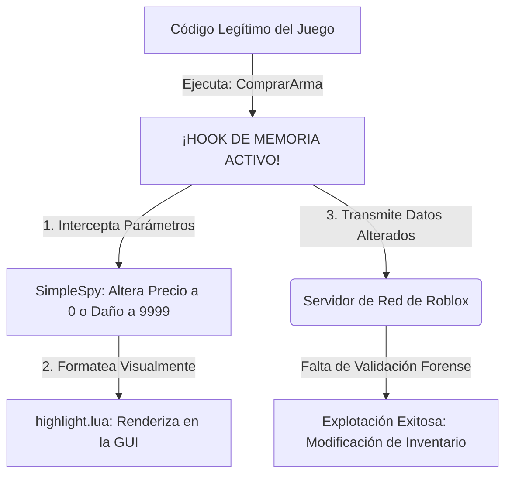

# 🔍 Análisis Forense de Memoria: Anatomía del Hooking de Remotos y Defensa Server-Authoritative en Luau
**Analista:** Sylvio Andrés Burgos (misteorecandy)  
**Clasificación:** Remotespy (variante nueva) / vulnerabilidades que beneficia a un exploiter lo cual se reporta esto
**Metodología de Auditoría:** [Análisis Estático Estructurado sobre Repositorio Fuente (GitHub)](https://raw.githubusercontent.com/exxtremestuffs/SimpleSpySource/master/SimpleSpy.lua)

---

## 📌 1. Resumen Técnico

Este documento presenta un estudio forense sobre los mecanismos de intercepción de funciones en la memoria RAM corporativa del cliente, tomando como caso de estudio la herramienta de auditoría ofensiva **SimpleSpy**. 

El análisis se centra en cómo los vectores de ataque aprovechan la falta de sanitización en el lado del servidor para manipular la capa de red (`RemoteEvents` y `RemoteFunctions`), y define la ingeniería defensiva necesaria para neutralizar por completo estas técnicas mediante una arquitectura **Server-Authoritative** (Autoridad Absoluta del Servidor).

---

## 🔬 2. Anatomía de la Intercepción de Funciones (Hooking)

Las herramientas de auditoría en el cliente operan interceptando el tráfico de red antes de que sea empaquetado y transmitido hacia el servidor. En entornos de ejecución Luau, esto se logra mediante dos técnicas de manipulación de punteros en memoria:

### A. Sustitución de Punteros de Función (`hookfunction`)
El inyector local localiza la dirección de memoria de la función nativa (por ejemplo, `game.RemoteEvent.FireServer`) y almacena una referencia en una variable segura (`originalEvent`). Posteriormente, desvía el flujo del motor hacia una rutina modificada:

```lua
-- Fragmento estructural del interceptor en memoria del cliente
local originalEvent = remoteEvent.FireServer

-- Reemplazo del puntero nativo para espionaje de argumentos
function hookFicticio(remote, ...)
    local args = {...}
    -- [SimpleSpy registra los argumentos aquí y los envía a highlight.lua]
    return originalEvent(remote, unpack(args)) -- Devuelve el control al motor nativo
end
```

### B. Manipulación de Metatablas Globales (`__namecall`)
Los objetos de red se gestionan mediante metamétodos. Al alterar la metatabla raíz del entorno de ejecución mediante `getrawmetatable(game)`, el script intercepta dinámicamente cualquier invocación de métodos de red filtrando la cadena `"FireServer"`.

---

## 📉 3. El Flujo de Manipulación de Red

Cuando un atacante utiliza un interceptor, el flujo de confianza se rompe si el servidor procesa los argumentos del cliente de manera ciega:



---

## 🛠️ 4. Análisis de Código: Vulnerabilidad vs. Mitigación

A continuación se expone un escenario crítico (Procesamiento de una pasarela de compras dentro del juego) para contrastar una infraestructura insegura frente a una arquitectura de programación defensiva.

### ❌ Caso Inseguro: Confianza Ciega en el Cliente
En este script, el servidor comete el error crítico de aceptar parámetros de precio y daño matemático provistos directamente por los argumentos del cliente (fácilmente modificables en la RAM mediante SimpleSpy).

```lua
-- SCRIPT DEL SERVIDOR (VULNERABLE)
local ReplicatedStorage = game:GetService("ReplicatedStorage")
local ComprarArmaEvent = ReplicatedStorage.ComprarArma

ComprarArmaEvent.OnServerEvent:Connect(function(player, nombreArma, precio, danio)
    -- ERROR: El servidor descuenta un precio manipulado por el cliente
    player.Coins.Value = player.Coins.Value - precio
    
    local nuevaArma = Instance.new("Tool")
    nuevaArma.Name = nombreArma
    nuevaArma.DanioBase.Value = danio -- ERROR: El atacante inyecta daño infinito
    nuevaArma.Parent = player.Backpack
end)
```

### 🛡️ Caso Mitigado: Arquitectura Server-Authoritative
En la solución segura, el servidor actúa como la **única fuente de verdad**. Se ignora cualquier valor numérico del cliente y se implementa una triple capa de validación (*Type Checking*, *Database Cross-Reference* y *Logic Sanity*).

```lua
-- SCRIPT DEL SERVIDOR (COMPLETAMENTE MITIGADO)
local ReplicatedStorage = game:GetService("ReplicatedStorage")
local ComprarArmaEvent = ReplicatedStorage.ComprarArma

-- 1. Base de datos estática protegida exclusivamente en el Servidor
local CATALOGO_ARMAS = {
	["RifleAsalto"] = { Precio = 500, DanioReal = 15 },
	["Pistola9mm"]  = { Precio = 150, DanioReal = 8 },
	["Escopeta"]    = { Precio = 750, DanioReal = 35 }
}

ComprarArmaEvent.OnServerEvent:Connect(function(player, nombreArmaRecibido)
	-- === CAPA DEFENSIVA 1: VERIFICACIÓN DE TIPOS (Type Checking) ===
	-- Mitiga ataques de denegación de servicio (DoS) o inyecciones de estructuras inesperadas
	if typeof(nombreArmaRecibido) ~= "string" then
		warn("[ALERTA SEGURIDAD]: " .. player.Name .. " envió un tipo de dato inválido.")
		return
	end

	-- === CAPA DEFENSIVA 2: CONTROL DE EXISTENCIA ===
	-- Contrasta el ID enviado contra la fuente de verdad del Servidor
	local datosArma = CATALOGO_ARMAS[nombreArmaRecibido]
	if not datosArma then
		warn("[ALERTA SEGURIDAD]: " .. player.Name .. " intentó llamar un ítem inexistente: " .. tostring(nombreArmaRecibido))
		return
	end

	-- === CAPA DEFENSIVA 3: CONSOLIDACIÓN DE FONDOS Y SOBERANÍA LOGICA ===
	local precioReal = datosArma.Precio
	local danioReal = datosArma.DanioReal
	local monedasJugador = player:FindFirstChild("Leaderstats") and player.Leaderstats:FindFirstChild("Coins")
	
	if not monedasJugador then return end

	-- Verificación matemática estricta antes de escribir en memoria
	if monedasJugador.Value >= precioReal then
		monedasJugador.Value = monedasJugador.Value - precioReal
		
		-- Instanciación segura con propiedades controladas por el Servidor
		local nuevaArma = Instance.new("Tool")
		nuevaArma.Name = nombreArmaRecibido
		
		local configDanio = Instance.new("IntValue")
		configDanio.Name = "DanioBase"
		configDanio.Value = danioReal -- El cliente no tiene control sobre este valor
		configDanio.Parent = nuevaArma
		
		nuevaArma.Parent = player.Backpack
		print("[LOG EXITOSO]: Transacción segura consolidada para " .. player.Name)
	else
		-- Si se alteró visualmente el dinero en el cliente, la discrepancia se intercepta aquí
		warn("[ALERTA ANTI-CHEAT]: " .. player.Name .. " intentó evasión de costos sin fondos suficientes.")
	end
end)
```

---

## ⚖️ Declaración de Uso Lícito (Disclaimer)

> [!NOTE]
> Esta documentación técnica se ha generado estrictamente con fines educativos, auditoría defensiva de software (*Blue Teaming*) y optimización de arquitectura de red en desarrollo de videojuegos. No se promueve ni se distribuye código ejecutable malicioso de explotación activa.
> 
